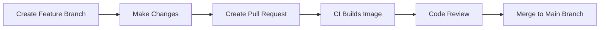
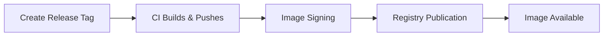

# CI/CD Pipeline Documentation

## GitHub Actions Workflow

### Overview
The Docker Image CI workflow automates the building, testing, and publishing of the Sonod Docker image using GitHub Actions.

### Workflow Configuration

#### File Location
`.github/workflows/docker-image.yml`

#### Trigger Events
```yaml
on:
  push:
    branches:
      - 20.04        # Ubuntu 20.04 based builds
      - 22.04        # Ubuntu 22.04 based builds
    tags:
      - v20.04.20*   # Version tags for Ubuntu 20.04
      - v22.04.20*   # Version tags for Ubuntu 22.04
  pull_request:
    branches:
      - 20.04
      - 22.04
```

#### Environment Variables
```yaml
env:
  REGISTRY: ghcr.io                    # GitHub Container Registry
  IMAGE_NAME: ${{ github.repository }} # Dynamic image name from repository
```

### Job Configuration

#### Build Job Specifications
- **Runner**: `ubuntu-latest`
- **Permissions**:
  - `contents: read` - Read repository contents
  - `packages: write` - Push to GitHub Container Registry
  - `id-token: write` - OIDC token for cosign signing

### Workflow Steps

#### 1. Repository Checkout
```yaml
- name: Checkout repository
  uses: actions/checkout@v3
```
**Purpose**: Downloads the repository code for building
**Dependencies**: None
**Output**: Repository files available in runner

#### 2. Cosign Installation (Conditional)
```yaml
- name: Install cosign
  if: github.event_name != 'pull_request'
  uses: sigstore/cosign-installer@v3.2.0
```
**Purpose**: Installs cosign for Docker image signing
**Condition**: Only runs on push events, not pull requests
**Security**: Enables image signature verification

#### 3. Docker Buildx Setup
```yaml
- name: Setup Docker buildx
  uses: docker/setup-buildx-action@79abd3f86f79a9d68a23c75a09a9a85889262adf
```
**Purpose**: Sets up Docker Buildx for advanced build features
**Features**:
- Multi-platform builds
- Build caching
- Advanced Dockerfile features

#### 4. Registry Authentication (Conditional)
```yaml
- name: Log into registry ${{ env.REGISTRY }}
  if: github.event_name != 'pull_request'
  uses: docker/login-action@28218f9b04b4f3f62068d7b6ce6ca5b26e35336c
  with:
    registry: ${{ env.REGISTRY }}
    username: ${{ github.actor }}
    password: ${{ secrets.GITHUB_TOKEN }}
```
**Purpose**: Authenticates with GitHub Container Registry
**Condition**: Only for push events (not pull requests)
**Credentials**: Uses GitHub token for authentication

#### 5. Docker Metadata Extraction
```yaml
- name: Extract Docker metadata
  id: meta
  uses: docker/metadata-action@98669ae865ea3cffbcbaa878cf57c20bbf1c6c38
  with:
    images: ${{ env.REGISTRY }}/${{ env.IMAGE_NAME }}
```
**Purpose**: Generates Docker tags and labels from Git metadata
**Output**: Tags and labels for Docker image
**Examples**:
- `ghcr.io/opsivist/sonod:22.04` (branch)
- `ghcr.io/opsivist/sonod:v22.04.20231201` (tag)

#### 6. Build and Push
```yaml
- name: Build and push Docker image
  id: build-and-push
  uses: docker/build-push-action@ac9327eae2b366085ac7f6a2d02df8aa8ead720a
  with:
    context: .
    push: ${{ github.event_name != 'pull_request' }}
    tags: ${{ steps.meta.outputs.tags }}
    labels: ${{ steps.meta.outputs.labels }}
    cache-from: type=gha
    cache-to: type=gha,mode=max
```
**Purpose**: Builds Docker image and pushes to registry
**Features**:
- **Context**: Uses current directory as build context
- **Conditional Push**: Only pushes on non-PR events
- **Caching**: Uses GitHub Actions cache for build optimization
- **Labels**: Applies metadata labels to image

#### 7. Image Signing (Conditional)
```yaml
- name: Sign the published Docker image
  if: ${{ github.event_name != 'pull_request' }}
  env:
    COSIGN_PASSWORD: ${{ secrets.COSIGN_PASSWORD }}
    COSIGN_PRIVATE_KEY: ${{ secrets.COSIGN_PRIVATE_KEY }}
    TAGS: ${{ steps.docker_meta.outputs.tags }}
  run: cosign sign --yes --key env://COSIGN_PRIVATE_KEY ${{ env.REGISTRY }}/${{ env.IMAGE_NAME }}:${TAGS}
```
**Purpose**: Signs Docker images for security verification
**Requirements**: 
- `COSIGN_PASSWORD` secret
- `COSIGN_PRIVATE_KEY` secret
**Security**: Enables image integrity verification

## CI/CD Pipeline Flow

### Development Workflow

#### 1. Feature Development


#### 2. Release Process


### Build Matrix

#### Branch-Based Builds
| Branch | Ubuntu Version | Image Tag |
|--------|----------------|-----------|
| `20.04` | Ubuntu 20.04 | `ghcr.io/opsivist/sonod:20.04` |
| `22.04` | Ubuntu 22.04 | `ghcr.io/opsivist/sonod:22.04` |

#### Tag-Based Builds
| Tag Pattern | Ubuntu Version | Image Tag |
|-------------|----------------|-----------|
| `v20.04.20*` | Ubuntu 20.04 | `ghcr.io/opsivist/sonod:v20.04.YYYYMMDD` |
| `v22.04.20*` | Ubuntu 22.04 | `ghcr.io/opsivist/sonod:v22.04.YYYYMMDD` |

### Security Features

#### Image Signing
- **Tool**: Cosign (sigstore)
- **Key Management**: GitHub Secrets
- **Verification**: `cosign verify --key <public-key> <image>`
- **Benefits**: Ensures image integrity and authenticity

#### Registry Security
- **Authentication**: GitHub token-based
- **Permissions**: Scoped to packages write
- **Access Control**: Repository-based permissions

### Performance Optimizations

#### Build Caching
```yaml
cache-from: type=gha    # Use GitHub Actions cache for layers
cache-to: type=gha,mode=max  # Save all layers to cache
```
**Benefits**:
- Faster builds through layer reuse
- Reduced build times for incremental changes
- Efficient use of GitHub Actions minutes

#### Conditional Operations
- **Pull Requests**: Build only (no push, no signing)
- **Push Events**: Full pipeline (build, push, sign)
- **Resource Efficiency**: Avoids unnecessary operations

## Usage in CI/CD

### GitLab CI Integration

#### Basic Pipeline
```yaml
# .gitlab-ci.yml
image: ghcr.io/opsivist/sonod:22.04

stages:
  - test
  - build
  - deploy

variables:
  PIP_CACHE_DIR: /home/gitlab-runner/.cache/pip

cache:
  paths:
    - /home/gitlab-runner/.cache/pip/
    - /home/gitlab-runner/.cache/git-autoshare/

test:
  stage: test
  script:
    - virtualenv venv
    - source venv/bin/activate
    - pip install -r requirements.txt
    - python -m pytest

build:
  stage: build
  script:
    - virtualenv venv
    - source venv/bin/activate
    - pip install -r requirements.txt
    - python setup.py bdist_wheel
  artifacts:
    paths:
      - dist/
```

#### Odoo-Specific Pipeline
```yaml
# .gitlab-ci.yml for Odoo projects
image: ghcr.io/opsivist/sonod:22.04

variables:
  PIP_CACHE_DIR: /home/gitlab-runner/.cache/pip
  PGHOST: postgres
  PGUSER: odoo
  PGPASSWORD: odoo
  PGDATABASE: test_odoo

services:
  - postgres:13

before_script:
  - virtualenv -p python3.11 venv
  - source venv/bin/activate
  - git clone https://github.com/odoo/odoo.git --depth 1 --branch 16.0
  - pip install -r odoo/requirements.txt

test_addons:
  script:
    - python odoo/odoo-bin -i base --stop-after-init --log-level=warn
    - python odoo/odoo-bin -i your_addon --test-enable --stop-after-init
```

### GitHub Actions Integration

#### Using as Base Image
```yaml
# .github/workflows/test.yml
name: Test

on: [push, pull_request]

jobs:
  test:
    runs-on: ubuntu-latest
    container:
      image: ghcr.io/opsivist/sonod:22.04
      volumes:
        - pip-cache:/home/gitlab-runner/.cache/pip
    
    steps:
      - uses: actions/checkout@v3
      
      - name: Setup Python environment
        run: |
          virtualenv venv
          source venv/bin/activate
          pip install -r requirements.txt
      
      - name: Run tests
        run: |
          source venv/bin/activate
          python -m pytest
```

### Jenkins Integration

#### Pipeline Script
```groovy
pipeline {
    agent {
        docker {
            image 'ghcr.io/opsivist/sonod:22.04'
            args '-v pip-cache:/home/gitlab-runner/.cache/pip'
        }
    }
    
    stages {
        stage('Setup') {
            steps {
                sh '''
                    virtualenv venv
                    source venv/bin/activate
                    pip install -r requirements.txt
                '''
            }
        }
        
        stage('Test') {
            steps {
                sh '''
                    source venv/bin/activate
                    python -m pytest --junitxml=test-results.xml
                '''
            }
            post {
                always {
                    junit 'test-results.xml'
                }
            }
        }
    }
}
```

## Monitoring and Maintenance

### Build Monitoring

#### Key Metrics
- **Build Duration**: Track build times for performance optimization
- **Success Rate**: Monitor build success/failure rates
- **Cache Hit Rate**: Measure Docker layer cache effectiveness
- **Image Size**: Monitor image size growth over time

#### Alerting
```yaml
# Example workflow with failure notifications
- name: Notify on failure
  if: failure()
  uses: actions/github-script@v6
  with:
    script: |
      github.rest.issues.createComment({
        issue_number: context.issue.number,
        owner: context.repo.owner,
        repo: context.repo.repo,
        body: '❌ Docker build failed. Please check the logs.'
      })
```

### Maintenance Tasks

#### Regular Updates
1. **Base Image Updates**: Monitor Ubuntu 22.04 security updates
2. **Dependency Updates**: Keep Python packages and tools updated
3. **Security Patches**: Apply security updates promptly
4. **Tool Updates**: Update git-autoshare, manifestoo, and other tools

#### Version Management
```bash
# Check current versions
docker run --rm ghcr.io/opsivist/sonod:22.04 python3 --version
docker run --rm ghcr.io/opsivist/sonod:22.04 git --version
docker run --rm ghcr.io/opsivist/sonod:22.04 pipx list

# Update strategy
# 1. Update Dockerfile with new versions
# 2. Test locally
# 3. Create pull request
# 4. Merge after review
# 5. Tag new release
```

### Troubleshooting CI/CD Issues

#### Build Failures

##### Common Causes
1. **Package Installation Failures**: Network issues or package unavailability
2. **Permission Issues**: File system permission problems
3. **Cache Corruption**: Docker layer cache issues
4. **Resource Limits**: Memory or disk space constraints

##### Debugging Steps
```bash
# Local reproduction
docker build -t sonod:debug .

# Interactive debugging
docker run -it --rm sonod:debug /bin/bash

# Check specific components
docker run --rm sonod:debug which git
docker run --rm sonod:debug pipx list
docker run --rm sonod:debug python3 -c "import sys; print(sys.version)"
```

#### Registry Issues

##### Authentication Problems
```bash
# Verify token permissions
echo $GITHUB_TOKEN | docker login ghcr.io -u $GITHUB_ACTOR --password-stdin

# Check repository permissions
gh api repos/$GITHUB_REPOSITORY --jq '.permissions'
```

##### Push Failures
```bash
# Check image size limits
docker images ghcr.io/opsivist/sonod:22.04

# Verify registry connectivity
curl -I https://ghcr.io/v2/

# Test manual push
docker tag local-image ghcr.io/opsivist/sonod:test
docker push ghcr.io/opsivist/sonod:test
```

## Integration Examples

### Multi-Stage Builds

#### Development and Production Images
```dockerfile
# Dockerfile.multi-stage
FROM ghcr.io/opsivist/sonod:22.04 as base

# Development stage
FROM base as development
USER root
RUN apt-get update && apt-get install -y \
    vim \
    tmux \
    htop
USER gitlab-runner

# Production stage  
FROM base as production
COPY requirements.txt .
RUN virtualenv venv && \
    source venv/bin/activate && \
    pip install -r requirements.txt
```

#### Usage
```bash
# Build development image
docker build --target development -t sonod:dev .

# Build production image
docker build --target production -t sonod:prod .
```

### Custom Workflow Examples

#### Matrix Strategy for Multiple Versions
```yaml
name: Multi-Version Test

on: [push, pull_request]

jobs:
  test:
    runs-on: ubuntu-latest
    strategy:
      matrix:
        ubuntu-version: [20.04, 22.04]
        python-version: [3.8, 3.9, 3.10, 3.11]
    
    container:
      image: ghcr.io/opsivist/sonod:${{ matrix.ubuntu-version }}
    
    steps:
      - uses: actions/checkout@v3
      
      - name: Test with Python ${{ matrix.python-version }}
        run: |
          virtualenv -p python${{ matrix.python-version }} venv
          source venv/bin/activate
          python --version
          pip install -r requirements.txt
          python -m pytest
```

#### Parallel Testing Strategy
```yaml
name: Parallel Tests

jobs:
  test:
    runs-on: ubuntu-latest
    container:
      image: ghcr.io/opsivist/sonod:22.04
    
    strategy:
      matrix:
        test-group: [unit, integration, e2e]
    
    steps:
      - uses: actions/checkout@v3
      
      - name: Run ${{ matrix.test-group }} tests
        run: |
          virtualenv venv
          source venv/bin/activate
          pip install -r requirements.txt
          python -m pytest tests/${{ matrix.test-group }}/
```

## Performance Optimization

### Build Time Optimization

#### Docker Layer Caching
```yaml
- name: Build with cache
  uses: docker/build-push-action@v4
  with:
    context: .
    cache-from: |
      type=gha
      type=registry,ref=ghcr.io/opsivist/sonod:cache
    cache-to: |
      type=gha,mode=max
      type=registry,ref=ghcr.io/opsivist/sonod:cache,mode=max
```

#### Dependency Caching
```yaml
- name: Cache dependencies
  uses: actions/cache@v3
  with:
    path: |
      ~/.cache/pip
      ~/.cache/git-autoshare
    key: ${{ runner.os }}-deps-${{ hashFiles('**/requirements.txt') }}
    restore-keys: |
      ${{ runner.os }}-deps-
```

### Resource Management

#### Memory Optimization
```yaml
jobs:
  build:
    runs-on: ubuntu-latest
    env:
      DOCKER_BUILDKIT: 1
      BUILDKIT_PROGRESS: plain
    steps:
      - name: Free disk space
        run: |
          sudo rm -rf /usr/share/dotnet
          sudo rm -rf /opt/ghc
          sudo rm -rf /usr/local/share/boost
```

#### Concurrent Builds
```yaml
strategy:
  matrix:
    include:
      - ubuntu: 20.04
        tag: 20.04
      - ubuntu: 22.04
        tag: 22.04
  max-parallel: 2
```

## Security Best Practices

### Image Security

#### Vulnerability Scanning
```yaml
- name: Run Trivy vulnerability scanner
  uses: aquasecurity/trivy-action@master
  with:
    image-ref: ${{ env.REGISTRY }}/${{ env.IMAGE_NAME }}:${{ steps.meta.outputs.tags }}
    format: 'sarif'
    output: 'trivy-results.sarif'

- name: Upload Trivy scan results
  uses: github/codeql-action/upload-sarif@v2
  with:
    sarif_file: 'trivy-results.sarif'
```

#### SBOM Generation
```yaml
- name: Generate SBOM
  uses: anchore/sbom-action@v0
  with:
    image: ${{ env.REGISTRY }}/${{ env.IMAGE_NAME }}:${{ steps.meta.outputs.tags }}
    format: spdx-json
    output-file: sbom.spdx.json
```

### Secret Management

#### Required Secrets
| Secret Name | Purpose | Format |
|-------------|---------|--------|
| `COSIGN_PASSWORD` | Cosign key password | String |
| `COSIGN_PRIVATE_KEY` | Cosign signing key | PEM format |
| `GITHUB_TOKEN` | Registry authentication | Auto-provided |

#### Secret Rotation
```bash
# Generate new cosign key pair
cosign generate-key-pair

# Update GitHub secrets
gh secret set COSIGN_PRIVATE_KEY < cosign.key
gh secret set COSIGN_PASSWORD
```

## Deployment Strategies

### Blue-Green Deployment
```yaml
- name: Deploy to staging
  if: github.ref == 'refs/heads/22.04'
  run: |
    # Update staging environment
    kubectl set image deployment/odoo-ci \
      odoo-ci=ghcr.io/opsivist/sonod:22.04

- name: Deploy to production
  if: startsWith(github.ref, 'refs/tags/v22.04')
  run: |
    # Update production environment
    kubectl set image deployment/odoo-ci \
      odoo-ci=ghcr.io/opsivist/sonod:${{ github.ref_name }}
```

### Rolling Updates
```yaml
- name: Rolling update
  run: |
    # Update with zero downtime
    kubectl patch deployment odoo-ci \
      -p '{"spec":{"template":{"spec":{"containers":[{"name":"odoo-ci","image":"ghcr.io/opsivist/sonod:${{ github.ref_name }}"}]}}}}'
    
    # Wait for rollout
    kubectl rollout status deployment/odoo-ci
```

## Monitoring and Observability

### Build Metrics
```yaml
- name: Report build metrics
  run: |
    echo "Build duration: ${{ steps.build-and-push.outputs.digest }}"
    echo "Image size: $(docker image inspect ${{ env.REGISTRY }}/${{ env.IMAGE_NAME }}:${{ steps.meta.outputs.tags }} --format='{{.Size}}')"
```

### Usage Analytics
```yaml
- name: Track image usage
  run: |
    # Report to analytics service
    curl -X POST https://analytics.example.com/api/builds \
      -H "Content-Type: application/json" \
      -d '{
        "repository": "${{ github.repository }}",
        "tag": "${{ steps.meta.outputs.tags }}",
        "size": "${{ steps.build-and-push.outputs.size }}",
        "timestamp": "${{ github.event.head_commit.timestamp }}"
      }'
```

## Troubleshooting Guide

### Common CI/CD Issues

#### Build Failures
1. **Check runner logs**: Examine GitHub Actions logs for specific errors
2. **Local reproduction**: Build locally to isolate issues
3. **Dependency conflicts**: Verify package compatibility
4. **Resource limits**: Check for memory/disk space issues

#### Push Failures
1. **Authentication**: Verify GitHub token permissions
2. **Registry connectivity**: Test registry access
3. **Image size**: Check if image exceeds registry limits
4. **Rate limits**: Verify API rate limit status

#### Signing Failures
1. **Secret availability**: Ensure cosign secrets are configured
2. **Key format**: Verify private key format is correct
3. **Permissions**: Check cosign binary permissions
4. **Network access**: Verify access to sigstore services

### Debug Commands
```bash
# Check workflow status
gh run list --workflow=docker-image.yml

# View specific run logs
gh run view <run-id> --log

# Check image details
docker manifest inspect ghcr.io/opsivist/sonod:22.04

# Verify image signature
cosign verify --key <public-key> ghcr.io/opsivist/sonod:22.04
```